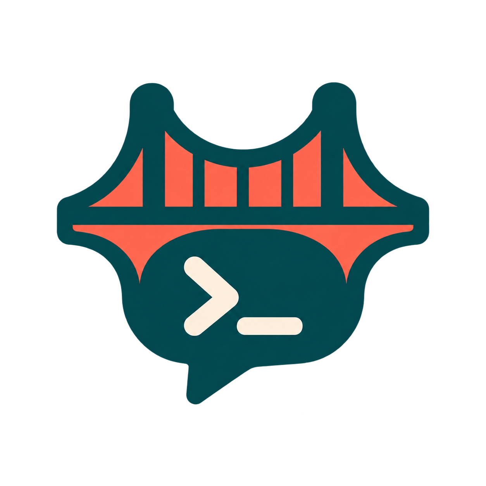
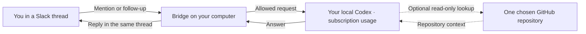

# Codex Slack Bridge

<p align="center">
  
</p>

**Talk to your own Codex from Slack, using your ChatGPT subscription's included
Codex usage—not API credits.** Get AI help in your team's Slack conversations
without setting up an API key or separate pay-per-token API billing.

The bridge connects to a local Codex process signed in with your own account.
Only the people and public channels you allow can use it, and each Slack thread
gets a separate Codex conversation. Account checks refuse API-key authentication,
paid credits, uncertain credit states and exhausted usage windows; the bridge
stops instead of falling back to paid API calls. Subscription limits still apply.

Slack Socket Mode routes messages to dedicated local Codex App Server sessions.
The bridge supports persisted queues, duplicate suppression, restart recovery,
threaded replies and Slack Markdown. Your computer must remain running.

## Explain it like I’m five

Think of the bridge as a messenger sitting on your computer. You mention your
bot in Slack, the messenger asks your own local Codex using your subscription,
and the answer comes back in the same Slack thread. There is no separate API
meter to fund. Each Slack thread gets its own Codex conversation.
If you enable GitHub reading, Codex can look at one chosen repository to help
answer questions. It can discuss code and suggest plans; it cannot edit code
or open pull requests through this bridge.



Your computer and the bridge must stay running. Only the people and public
channels you explicitly allow can use your runner. Messages received while it
is offline are not guaranteed to arrive later.

## Let an agent set it up

Give your coding agent this repository URL and ask it to follow
[the agent setup guide](docs/agent-setup.md). It includes a copyable task,
Linux/macOS/WSL steps, private configuration and a handoff checklist.
You authenticate locally and enter Slack tokens in a hidden prompt.

## Get the code

```bash
git clone https://github.com/Jordy-VL/codex-slack-bridge.git
cd codex-slack-bridge
```

## Install

Requires [uv](https://docs.astral.sh/uv/getting-started/installation/), Python 3.11+, Bash, and a Codex executable already signed in with
ChatGPT. Linux, macOS and WSL are supported by the launcher; live compatibility
must be checked against your installed Codex version. No PowerShell is required.

```bash
uv sync --locked
mkdir -p "$HOME/.config/codex-slack-bridge"
chmod 700 "$HOME/.config/codex-slack-bridge"
cp examples/bridge.example.toml "$HOME/.config/codex-slack-bridge/bridge.toml"
chmod 600 "$HOME/.config/codex-slack-bridge/bridge.toml"
```

Edit that private TOML: set your Slack workspace/channel/user IDs, the signed-in
Codex executable/config, an empty session working directory and a private state
directory. Use absolute paths. With a Windows Codex executable launched from
WSL, use `/mnt/c/.../codex.exe` for the executable and a Windows path for
`codex_cwd`; the config path is accessible through `/mnt/c/...`.

## Set up Slack and start

1. Create a Slack app from `examples/slack-app-manifest.json`, choose its bot
   name, review the three public-channel scopes, and install it in your workspace.
2. Enable Socket Mode and generate an app-level token with `connections:write`.
   Keep both the `xapp-` and installed `xoxb-` tokens outside Git and chat.
3. Invite the bot to each allowlisted public channel. Use a separate Slack app
   and token pair per personal runner; Socket Mode load balances shared tokens.
4. Run the check below. Verify included usage and paid-overage settings before
   setting `included_usage_verified = true` in your private TOML.
5. Start the Bash launcher, which prompts for tokens with hidden input. Mention
   the bot in an allowed channel, then reply in the same thread to continue.

```bash
uv run --locked codex-slack-bridge --config "$HOME/.config/codex-slack-bridge/bridge.toml" --check
./scripts/start-slack-bridge.sh "$HOME/.config/codex-slack-bridge/bridge.toml"
```

The launcher also accepts tokens already supplied through environment variables
by your secret manager. Never place token literals in command history. Run
`uv sync --locked` to install the committed versions. The launcher uses uv and
locates its checkout even when started from another directory. Ctrl+C stops it.

## Boundaries and recovery

Discussion/planning only: shell, general MCP, plugins, hooks and other execution
tools are disabled and checked. Optional GitHub reads are restricted to one
explicitly configured **github.com** repository, including private repositories
that your existing GitHub CLI login can read. GitHub Enterprise hosts are not
currently supported. Authenticate `gh` locally before enabling the reader.

Add this to your private bridge TOML (replace the uv/project paths and slug):

```toml
github_mcp_command = [
  "/absolute/path/to/uv", "run", "--locked", "--no-dev",
  "--project", "/absolute/path/to/codex-slack-bridge",
  "--", "python", "-m", "codex_slack_bridge.jobs.github_mcp",
  "--repository", "your-org/your-repo"
]
```

This command runs on the **Codex host**. For Windows Codex with a WSL worker,
use the `wsl.exe` command example in [operations](docs/operations.md).
The repository is required; there is no implicit repository. Tool arguments
cannot override it, and searches reject results from another repository. Reads
without an explicit ref discover the repository's default branch. Omit the
whole command for conversation-only mode. Original MCP tool identifiers are
retained for compatibility; they do not determine the repository.

Drain the queue and restart after changing this command. The worker command,
including repository, is part of the session profile: a changed scope creates
a fresh underlying session for the same Slack thread, carrying that thread's
recorded history as quoted context. Use a new Slack thread if you want a fresh
conversation without that history.

The bridge checks ChatGPT authentication and account usage before turns and
refuses unknown credit states, paid credits or exhausted windows. A check does
not make a model call or establish live Slack connectivity. Codex feature flags
and account response schemas are version sensitive and fail closed.

Accepted messages and answers persist locally. Messages sent while offline are
not guaranteed to arrive later. Crashes during generation/posting require review;
the bridge never silently replays ambiguous work. After stopping it:

```bash
uv run --locked codex-slack-bridge --config /private/bridge.toml --status
uv run --locked codex-slack-bridge --config /private/bridge.toml --skip 12
```

Inspect Slack before skipping. Keep SQLite/state private, retain the database,
and verify no process remains before removing a stale runner lock.
See [operations and recovery](docs/operations.md) for the full protocol, optional
GitHub worker configuration, limitations and live acceptance checklist.

The committed `uv.lock` pins dependencies. `uv sync --locked` and
`uv run --locked` reject a stale lockfile instead of silently updating it.
Development dependencies install by default; the launcher uses `--no-dev`.

## Tested end to end

**Live Slack → Codex → Slack testing passed on 23 October 2026**, using the
packaged Bash/uv launcher, Windows Codex with a WSL bridge and GitHub worker,
and ChatGPT subscription authentication.

- A Slack mention reached Codex and its answer returned in the same thread.
- A plain follow-up retained the earlier conversation context.
- The read-only GitHub tool retrieved this repository's `pyproject.toml` and
  returned accurate package details with a commit-pinned source link.
- A separate Slack thread used a distinct Codex session without the first
  thread's conversation context.

All three test requests completed successfully and passed the runtime
included-usage checks. The temporary runner was stopped after its queue drained.
This validates the tested installation; check your own Codex version and setup
with preflight and a live exchange. Native Linux/macOS configurations have not
yet been live-tested.

## Local validation

```bash
uv run --locked pytest
bash -n scripts/start-slack-bridge.sh
```

Tests use fake transports and do not send Slack messages or run model turns.
A live smoke test requires your own credentials and separately started runner.

Protocol reference: [official Codex App Server documentation](https://learn.chatgpt.com/docs/app-server).
